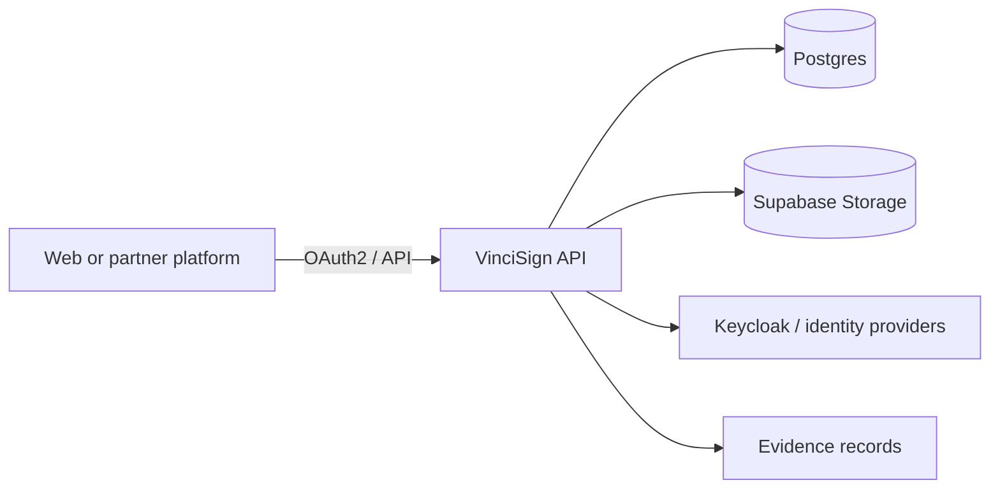

# VinciSign

VinciSign is an API-first signing platform for creating, sending, signing, protecting, and verifying documents from any product. The web application demonstrates the platform; the public API is the integration surface.

The product is organized around five capabilities: **Sign**, **Protect**, **Verify**, **Passport**, and **Vault**.

Electronic notarization is a separate regulated capability. VinciSign must not present an electronically signed document as notarized unless the required accreditation, commissioned electronic notary, and applicable process are in place.

## Repository status

This repository is the foundation for the platform. Authentication, user management, local infrastructure, OpenAPI generation, and a legacy todo smoke test are currently present. The todo module is not a product feature; it will be replaced by the first document-project vertical slice.

The current build is intentionally small: Spring Boot API, PostgreSQL, and Supabase Storage. The first document flow accepts ready PDF/PDF-A files, stores them, calculates SHA-256, records evidence, and responds synchronously. Mobile is out of scope and must not be modified. Redis, workers, conversion services, malware scanning, notification providers, webhooks, and external synchronization are deferred.

The product requirements and delivery sequence are documented in [`docs/doconchain-replication-plan.md`](docs/doconchain-replication-plan.md), [`implementation-plan.md`](implementation-plan.md), and the detailed [`docs/vincisign-gantt-timeline.md`](docs/vincisign-gantt-timeline.md). The DocOnChain plan is a functional reference, not a branding or implementation-copying instruction.

## Stack

- **Web:** Next.js App Router, TypeScript, Tailwind, shadcn/ui, Auth.js, TanStack Query, Zustand.
- **API:** Spring Boot 4, Java 21, Maven, Spring Security OAuth2 Resource Server, PostgreSQL, Flyway, MapStruct, Testcontainers.
- **Identity:** Keycloak in local development, with Google/GitHub providers available through identity-provider configuration.
- **Shared contract:** OpenAPI-generated TypeScript client.

## Local development

### Prerequisites

- Node.js 20
- pnpm 10.12.1
- Java 21
- Docker with Docker Compose

### Start the platform

```bash
make dev
```

This starts local Postgres and Keycloak, then the API and web client. The web app is available at `http://localhost:3000`; the API is available at `http://localhost:8080`.

```bash
make backend-test
pnpm --filter @app/frontend lint
pnpm --filter @app/frontend typecheck
```

## Architecture



## API principles

1. Every side-effecting write supports an idempotency key where retries could create a project, signature, payment, or webhook effect.
2. Document versions are immutable after signing or notarization; replacements create a new version and evidence history.
3. State transitions record actor, timestamp, version, participant role, request/session context, and reason when applicable.
4. API clients are scoped to an organization and have explicit permissions, rate limits, usage records, and revocation.
5. Webhooks are a future signed integration extension; they are not required by the initial document flow.
6. Signing evidence, completion certificates, and notarization records are separate connected records.

## Project conventions

Backend modules use vertical slices under the current template package path. The target Java package is `com.vincisign.backend`, but the package migration must be coordinated rather than performed piecemeal. Entities use Lombok; API DTOs use Java records; persistence changes use Flyway migrations. Frontend server data belongs in TanStack Query, session state belongs to Auth.js, and ephemeral UI state belongs to Zustand.

The existing `com.vencentdev.backend` package and `@app/*` package scope are template-era technical names scheduled for the foundation cleanup. They should be changed in one coordinated migration before the first public release, not piecemeal inside feature work.

## Legal and compliance boundary

Before production launch, define supported jurisdictions, document types, signature types, retention/deletion rules, legal holds, certificate revocation, data processing, incident response, and electronic-notarization responsibilities. Review the platform’s terms, privacy notice, electronic-record consent, electronic-signature consent, acceptable-use policy, and enterprise agreements with qualified counsel.
