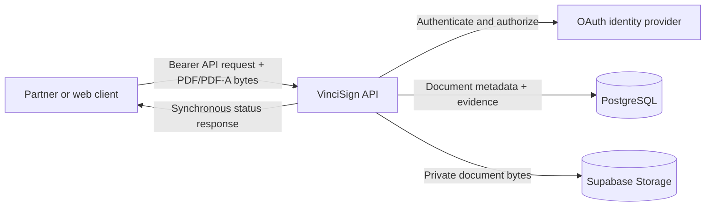

# VinciSign Threat Model and Privacy Impact Baseline

**Status:** Approved for system construction as an implementation baseline; formal legal review deferred  
**Version:** 0.1  
**Confirmed:** 2026-11-14  
**Scope:** Current template security surface and the first simple document flow  
**Product:** VinciSign, Philippines-first, API-first signing platform

This document is a source-backed architecture and privacy baseline. It is not a penetration test, legal opinion, accreditation decision, or claim that every control is already implemented. Scenarios marked as hypotheses are implementation risks to address or verify.

## 1. Overview and supported flow

The current repository contains a Spring Boot API, a Next.js web client, PostgreSQL/Flyway persistence, OAuth-based authentication, and a legacy todo smoke test. The first VinciSign slice is intentionally smaller: an authenticated caller submits a ready PDF/PDF-A file to the API; the API validates the file, stores it in Supabase Storage, calculates SHA-256, writes PostgreSQL metadata and evidence, and returns the result synchronously. Redis, workers, conversion, malware scanning, notification providers, webhooks, and external synchronization are deferred by the architecture baseline.

| Component or workflow | Current or planned role | Security-relevant evidence |
|---|---|---|
| Partner/web client | Sends authenticated API requests and user-controlled document bytes | `apps/frontend/src/lib/api.ts:18-30`; `docs/api-contract-standards.md:277-281` |
| Spring Boot API | Stateless authentication, authorization boundary, validation, metadata/evidence transaction | `apps/backend/src/main/java/com/vencentdev/backend/config/SecurityConfig.java:23-53` |
| OAuth providers | Current template resolves Google/GitHub user information from a bearer token | `apps/backend/src/main/java/com/vencentdev/backend/modules/auth/oauth/OAuthProviderUserInfoClient.java:22-107` |
| PostgreSQL/Flyway | User records now; project, document version, and evidence records in the first slice | `apps/backend/src/main/resources/application.yml:4-13`; `apps/backend/src/main/resources/db/migration/V1__init.sql:3-17` |
| Supabase Storage | Planned private object store for accepted document bytes and artifacts | `docs/adr/0008-vincisign-platform-foundation.md:35-45` |
| Legacy todo module | Template smoke test only; not part of the VinciSign data boundary | `AGENTS.md:22-24`; `apps/backend/src/main/java/com/vencentdev/backend/modules/todo/service/TodoServiceImpl.java:34-89` |

The planned flow must not expose a document object directly to a caller before the API has checked organization/project authorization. Storage access is an application-controlled capability, not a substitute for domain authorization.

## 2. Protected assets and privacy inventory

| Asset or data | Classification | Purpose | Initial access boundary | Retention/deletion baseline |
|---|---|---|---|---|
| PDF/PDF-A document bytes | Confidential, potentially highly sensitive | Document signing and verification | Authorized project members through the API; private Supabase object | Retain according to project policy; never overwrite a version in place |
| Document filename, media type, size, object key, and SHA-256 | Confidential/integrity-sensitive | Identify and verify the stored version | Organization/project authorization; limited public verification summary | Retain with the version/evidence record |
| Evidence events and event hashes | Integrity-sensitive and potentially personal | Explain how a document was received and changed | Authorized organization/admin paths; append-only application behavior | Preserve for the project/evidence retention period; corrections are new events |
| Account identity | Personal | Authenticate and associate actions | Authenticated self-access plus server authorization | Retain only as needed for account, audit, and project obligations |
| Email and display name | Personal | Account contact and signer/project display | Organization/project policy and least privilege | Do not expose in public verification unless policy permits |
| External identity subject | Personal identifier | Stable account correlation with the identity provider | Backend only; do not expose as a public document identifier | Retain while the account/audit relationship requires it |
| `role`, `userType`, `identityLevel`, and `contactVerificationStatus` | Personal/security metadata | Authorization and identity policy | Server-owned; never trusted from client input | Retain with the account record and audit history |
| Bearer access token | Secret/authentication material | Authenticate the current request | Runtime request processing only | Do not persist or log; browser/session handling must be minimized |
| Request ID and audit timestamps | Operational metadata | Trace a request and correlate evidence | API logs and evidence references with access control | Retain according to operational/audit policy; validate caller-provided IDs |
| Address/phone/contact data | Personal, possibly sensitive | Future account/contact workflows | Not part of the initial document intake | Do not collect for the first slice unless required by a defined feature |
| Identity, location, liveness, video, notarial, and government-ID evidence | Highly sensitive | Future regulated signing/notarization controls | Not collected by the simple document intake | Explicit future policy and provider decision required |

The current user table stores `external_id`, email, display name, role, user type, identity level, contact-verification state, and audit timestamps; those account fields do not by themselves establish government identity verification (`apps/backend/src/main/resources/db/migration/V4__remove_template_kyc_status.sql`; `apps/backend/src/main/java/com/vencentdev/backend/modules/user/entity/User.java:34-74`).

## 3. Threat model, trust boundaries, and assumptions

### Actors and capabilities

| Actor | Starting capability | Does not automatically have |
|---|---|---|
| Unauthenticated internet caller | Probe public endpoints and submit malformed requests | Any protected project, document, account, or storage access |
| Authenticated organization member | Use the API actions granted to the authenticated account and submit their own files | Another organization’s resources, admin powers, or server-owned status changes |
| Compromised bearer-token holder | Act as the token subject until the token expires or is revoked | Other users’ data unless authorization/tenant isolation fails |
| Malicious file submitter | Choose PDF/PDF-A bytes, filename, content type, size, and request retry behavior | Server-side storage credentials, database credentials, or parser host privileges |
| Organization administrator | Manage organization-authorized resources when that role is implemented | Unrestricted platform/operator access or evidence deletion by ordinary API action |
| Platform operator/database or storage administrator | Infrastructure-level access required to operate the service | A presumption that operational access is equivalent to ordinary user authorization; all access must be logged and restricted |
| OAuth provider | Return authenticated identity data over the configured provider boundary | VinciSign project ownership unless the API maps the identity and applies authorization |

### Trust boundaries

1. **Client → API.** Bearer credentials, request headers, filenames, media types, file bytes, IDs, and idempotency inputs cross from caller-controlled space. The API must authenticate, authorize, validate, limit, and normalize these values.
2. **API → OAuth provider.** The current template sends the bearer token to provider user-info endpoints and maps the response to an internal principal. Provider identity and token validation must not be treated as client-provided claims.
3. **API → PostgreSQL.** The API writes personal account data, document metadata, and evidence. Database credentials and schema privileges are server-side; resource queries must include organization/project authorization predicates.
4. **API → Supabase Storage.** The API sends document bytes and object metadata to a private storage boundary. Object names, bucket policy, credentials, signed URLs, and download authorization must be controlled by the server.
5. **Application roles → evidence.** Ordinary application code may append facts and named corrections but must not silently edit or delete prior evidence. Database/operator capabilities are a separate privileged boundary.
6. **Current template → VinciSign migration.** Existing todo routes and the `com.vencentdev.backend` package are template surfaces. They are not evidence that the VinciSign project/storage controls exist; new product work must not copy their ownership model without review.

### Security objectives and invariants

- Only an authenticated, authorized organization/project actor can create, read, replace, or download a document version.
- A client cannot choose or overwrite organization ownership, evidence authorship, validation status, fingerprint, eligibility, or notarization state.
- Stored document bytes and their SHA-256 fingerprint refer to the same exact version; replacement creates a new version.
- Private storage objects are not guessable or directly public, and a storage URL does not bypass API authorization.
- Evidence events are append-oriented, ordered, hash-linked where enabled, and available for authorized review.
- Access tokens, storage credentials, database credentials, and private identity data are not written to logs or evidence payloads.
- File type, size, readability, and password/encryption checks complete before a document becomes eligible for the next workflow step.
- The initial flow remains bounded: 25 MB per file by default, synchronous processing, PDF/PDF-A only, and no unapproved provider/worker dependency.
- Privacy requests and government requests are handled through authenticated, reasoned, auditable operations; neither is implemented as an ad hoc database query or deletion.

### Assumptions and unresolved prerequisites

- The storage boundary now uses server-only Supabase credentials, opaque object keys, and
  short-lived signed access. Deployment must still create/configure the bucket as private, and
  the later document endpoint must authorize the caller before requesting a signed URL.
- TLS protects API, identity-provider, database, and storage connections in deployed environments. Deployment configuration still needs verification.
- The initial document flow does not scan for malware. The product must not expose a false “scanned” status; security scanning requires a later policy/architecture decision.
- The first flow does not perform DOCX conversion, background processing, notifications, webhooks, or external synchronization.
- Formal Philippine legal, privacy, ENP/ENF, and accreditation review remains outside this system-build ticket.
- The current OAuth filter performs provider user-info lookups; issuer, audience, token lifetime, and provider mix-up requirements must be verified before production use.
- Retention, deletion, legal hold, data-subject request fulfillment, cross-border storage region, breach notification, and government-request procedures require explicit operational values before production launch.

## 4. Attack surface, mitigations, and attacker stories

These are prioritized implementation scenarios, not validated vulnerabilities.

| Priority | Scenario and capability gain | Prerequisites | Impact | Existing controls | Mitigation / required test | Evidence |
|---|---|---|---|---|---|---|
| P0 | **Cross-organization document access.** A caller changes a project/document ID and reads or downloads another organization’s bytes. | A missing or incorrectly applied organization/project predicate, or a storage URL that bypasses the API. | Confidentiality breach and possible evidence disclosure. | Current todo queries scope by owner (`TodoServiceImpl.java:36-43`, `58-63`); VinciSign project authorization is not implemented yet. | Require server-derived organization scope on every query/mutation; use opaque object keys and private storage; add cross-tenant integration tests for metadata, bytes, and evidence. | `AGENTS.md:36`; `docs/adr/0008-vincisign-platform-foundation.md:37-45` |
| P0 | **Unauthorized download through storage capability.** A leaked, guessable, public, or long-lived object URL exposes a document. | Public bucket policy, predictable keys, service credential leakage, or signed URL issued without project authorization. | Document confidentiality loss. | The storage adapter uses opaque keys and short-lived signed URLs; the authorized document download endpoint does not exist yet. | Keep storage credentials server-side; authorize before issuing a short-lived URL or stream; never use raw project/document IDs as keys; test expired/revoked access. | `docs/tickets/VS-FND-006-storage-abstraction.md`; `docs/adr/0008-vincisign-platform-foundation.md:37-45` |
| P0 | **Bearer-token theft or replay.** A stolen browser/session/API token is reused to call protected endpoints. | Token exposure through browser state, logs, malicious extension/XSS, or insecure deployment; current API is stateless. | Account actions and document access as the token subject. | Spring Security requires authentication for non-public routes (`SecurityConfig.java:37-49`); frontend attaches the token as a bearer header (`apps/frontend/src/lib/api.ts:23-30`). | Validate issuer/audience/expiry and scopes; minimize browser token exposure; never log tokens; add token-lifetime/revocation assumptions and replay tests; require TLS. | `SecurityConfig.java:29-49`; `apps/frontend/src/lib/auth.ts:34-47` |
| P0 | **Forged or missing tenant ownership.** A client supplies organization/project ownership or server-owned document status. | Product endpoints trust request-body fields or omit authorization checks. | Cross-tenant writes, false evidence, or unauthorized workflow progression. | Agent rules and API standards require server-owned ownership/status, but project endpoints do not exist yet. | Derive ownership from authenticated principal and organization membership; make validation/fingerprint/evidence fields server-owned; reject generic status patches. | `AGENTS.md:36-38`; `docs/api-contract-standards.md:17-21` |
| P1 | **Malicious or resource-exhausting PDF/PDF-A.** A crafted file causes parser abuse, excessive memory/CPU, or oversized storage use. | A parser implementation that follows unsafe content, missing size/time limits, or unbounded concurrent uploads. | Availability impact or compromise of a parsing component. | Initial policy caps files at 25 MB and accepts PDF/PDF-A only; malware scanning is explicitly deferred. | Enforce size before storage; use a bounded, non-executing parser; cap request/body/time/resource usage; keep parsing in-process only for the simple flow; add malformed/encrypted/corrupt fixture tests and storage quotas. | `docs/document-policy.md:30-45`; `docs/adr/0008-vincisign-platform-foundation.md:48-57` |
| P1 | **Content-type or filename confusion.** A non-PDF payload is accepted because a filename or header is trusted. | Validation checks only the client media type or extension. | Unsafe bytes stored or processed under a false document classification. | Policy requires PDF/PDF-A and readability validation. | Inspect magic bytes and parser result; treat filename/media type as metadata only; store the validated type; reject mismatch with a safe error. | `docs/document-policy.md:30-45`; `docs/document-policy.md:158-174` |
| P1 | **Evidence mutation or deletion.** An application path updates/deletes a prior event or rewrites a document version after fingerprinting. | Missing database constraints, broad repository methods, admin bypass, or object overwrite. | Loss of auditability and inability to prove which bytes were used. | ADR requires append-oriented evidence, SHA-256, and new versions for replacement. | Use append-only service methods, restricted database grants, immutable object keys, transactionally linked metadata/evidence, and tests for replacement/deletion/duplicate requests. | `docs/adr/0008-vincisign-platform-foundation.md:48-75`; `docs/evidence-event-contract.md:356-365`, `367-373` |
| P1 | **Hash/byte mismatch.** The stored object differs from the bytes fingerprinted or the metadata claims a different content type/size. | Hashing a separate request stream, mutable storage object, retry race, or unverified provider response. | Integrity verification returns a false match or false mismatch. | ADR requires SHA-256 over exact stored bytes and immutable version references. | Compute from the exact bytes committed to storage; verify stored metadata/size/fingerprint before committing the version; reject partial writes; test retry and storage failure paths. | `docs/adr/0008-vincisign-platform-foundation.md:59-66` |
| P1 | **OAuth identity mix-up or weak token validation.** A token is accepted through the wrong provider path or identity claims are mapped without production issuer/audience checks. | Current filter tries Google then GitHub user-info calls and the deployment lacks explicit provider validation. | Account confusion or authentication bypass if provider assumptions fail. | Provider user-info responses supply the mapped subject; protected API routes require authentication. | Use explicit provider/issuer configuration, validate token audience/issuer/expiry, bind subject to provider, avoid ambiguous fallback, and add negative provider tests. | `OAuthProviderUserInfoClient.java:22-48`, `53-107`; `SecurityConfig.java:37-52` |
| P1 | **Admin/operator overreach.** A privileged operator reads document bytes, identity data, or evidence without a recorded business reason. | Broad database/storage credentials or missing privileged access logging. | Confidentiality, privacy, and trust loss. | No VinciSign admin document workflow exists yet; evidence policy requires restricted access. | Separate application/admin/operator roles; reason-require sensitive access; log and review access; do not use production service credentials for ordinary user actions. | `docs/evidence-event-contract.md:354-365`; `docs/adr/0008-vincisign-platform-foundation.md:69-75` |
| P1 | **Privacy request or government request handled informally.** A deletion/export or disclosure request is fulfilled without identity, scope, hold, or legal-process checks. | No request workflow, retention policy, legal hold, or audit record. | Unlawful disclosure, premature deletion, or inability to respond consistently. | Privacy and retention are identified as required operating decisions, not implemented in this slice. | Add authenticated request records, scope verification, retention/legal-hold checks, approval/reason capture, export redaction, and evidence of the response before production. | `docs/project-brief.md:18-31`; `docs/legal-operating-document-inventory.md:31-60` |
| P2 | **Request-ID spoofing or log correlation abuse.** A caller supplies an arbitrary `X-Request-Id` and it is placed into MDC/log responses. | Request ID is not constrained to a safe length/format and logs trust it as an authoritative trace. | Log confusion, possible log-injection noise, or misleading support evidence. | Filter returns the same request ID and uses MDC (`RequestIdFilter.java:17-36`). | Accept only bounded UUID/correlation formats or replace invalid values; encode structured logs; never use request ID as an authorization or evidence identity. | `apps/backend/src/main/java/com/vencentdev/backend/common/web/RequestIdFilter.java:17-36` |

## 5. Privacy impact baseline

### Purpose and proportionality

The initial processing purpose is to receive an organization-authorized document, preserve the accepted bytes, calculate an integrity fingerprint, and record the events needed to operate and verify the workflow. Do not collect government IDs, liveness/video, location, payment data, or notarial-session data for this first upload flow. Ordinary contact information is not a substitute for legal identity proof.

### Collection and use controls

- Accept only fields required for project ownership, document intake, storage, fingerprinting, evidence, and the selected workflow.
- Treat filenames, email addresses, display names, external identity subjects, document contents, and evidence as personal or confidential where they can identify a person or organization.
- Keep server-owned status, ownership, fingerprints, and evidence identifiers out of client-controlled write fields.
- Do not place bearer tokens, document bytes, private storage URLs, identity documents, or full evidence payloads in application logs, error messages, URLs, or analytics events.
- Public verification, when implemented, must return the minimum permitted result and must not expose an unrestricted event stream.

### Access and retention

- Organization membership and project authorization are the primary access controls.
- Supabase objects remain private; API authorization precedes every read/download capability.
- Retention must be attached to the project/document policy and must block deletion under an active legal hold or evidence obligation.
- A data-subject request may result in access, correction through a new event, restricted export, or deletion only after identity, scope, retention, and legal-hold checks.
- Government requests require authenticated intake, scope validation, legal-process handling, minimum necessary disclosure, and an evidence event. This baseline does not determine whether a request is legally valid.

### Privacy risks and controls still needed

| Risk | Initial control or decision | Required before production |
|---|---|---|
| Excessive document/identity collection | PDF/PDF-A only; no identity/location/video/notary evidence in the first intake | Document purpose and field-level minimization review |
| Cross-organization disclosure | Server-owned organization/project authorization; private storage | Automated isolation tests and access review |
| Over-retention | Policy/version and retention references are part of the architecture | Concrete retention schedule, deletion workflow, legal-hold behavior, and restore test |
| Operator access | Restricted application roles and append-oriented access evidence | Privileged access inventory, reason codes, monitoring, and review cadence |
| Cross-border processing | Supabase region/provider is an explicit deployment decision | Record region, subprocessors, transfer assessment, and customer disclosures |
| Data breach | Minimize logs and keep storage/database access restricted | Incident response, notification decision tree, credential rotation, and recovery exercise |

## 6. Security-control backlog

These controls are part of implementation planning; they do not authorize adding deferred infrastructure.

### Required for the simple first flow

1. Implement organization/project authorization before document metadata, bytes, or evidence endpoints.
2. Accept direct multipart PDF/PDF-A only; enforce the 25 MB default before storage and validate bytes/readability/password state.
3. Use private Supabase Storage, opaque object keys, server-side credentials, and API-mediated access.
4. Compute SHA-256 over the exact accepted bytes and persist the fingerprint with the same immutable version record.
5. Append upload, validation, fingerprint, rejection, and eligibility events; prevent normal application deletion or mutation.
6. Require idempotency for side-effecting project/document writes and make retries deterministic.
7. Validate OAuth issuer/provider/audience/expiry assumptions and keep access tokens out of logs and persisted records.
8. Add tests for cross-organization access, unauthorized downloads, malformed files, size limits, password-protected files, storage failures, replacement, duplicate requests, and evidence immutability.

### Deferred extensions

Redis, background workers, document conversion, malware scanning, notification providers, webhooks, external synchronization, identity/liveness providers, and production electronic-notarization operations require separate architecture/policy decisions. They are not dependencies of the simple first flow.

## 7. Severity calibration

- **Critical:** A remotely reachable control failure lets an unauthenticated caller execute server code, obtain platform-wide storage/database credentials, or read many organizations’ documents without authentication. No such outcome is established by this baseline.
- **High:** A missing tenant predicate or public storage boundary exposes another organization’s document/evidence; a production authentication failure permits account takeover across users; an evidence overwrite defeats the core integrity promise.
- **Medium:** A crafted upload causes significant resource exhaustion in the API, a weak request correlation control corrupts audit investigation, or an operator can access a limited sensitive record without a reason/audit trail.
- **Low:** A self-only metadata leak, cosmetic error detail, or bounded trace mismatch that does not grant a new resource or privilege.

Severity depends on actual deployment, authorization predicates, storage policy, token validation, data volume, and reachability. The scenarios above remain hypotheses until the corresponding implementation is reviewed and tested.

Repository: vincisign local workspace
Version: working tree based on revision `c21520cb910c1dcc4089ddba352b8ec77d83ec96`
