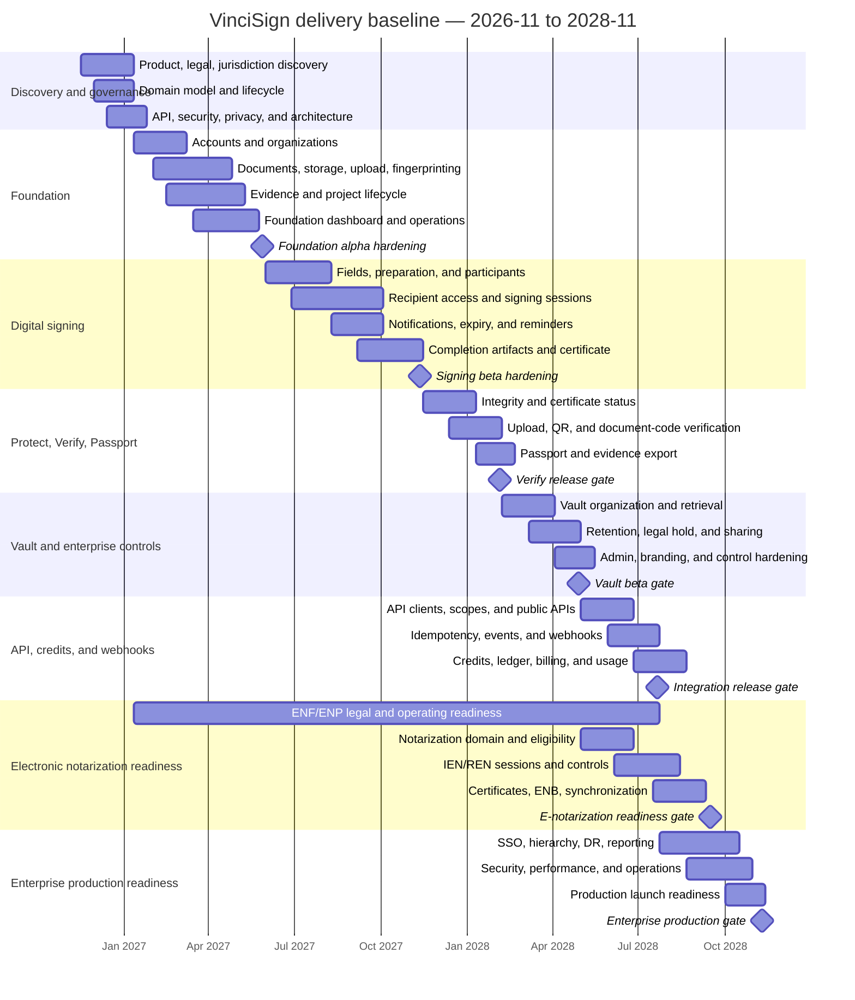

# VinciSign Full Delivery Gantt and Ticket Plan

> Baseline plan: 52 two-week sprints, 24 months, beginning 2026-11-16. This is a planning baseline for a small cross-functional product team, not a guaranteed launch date. Re-estimate after the first discovery gate.

## 1. Planning assumptions

### Team model

The schedule assumes these shared capacities:

- 1 product owner/program lead.
- 1 legal and compliance lead, with external counsel for jurisdictional review.
- 2 backend engineers.
- 1 web/frontend engineer.
- 1 platform/infrastructure engineer shared across the program.
- 1 QA/reliability engineer shared across the program.
- Security, identity, payments, storage, and electronic-notarization specialists consulted when their work begins.

Mobile is not part of this roadmap. The web client, Spring Boot API, shared OpenAPI types, infrastructure, and product operations are in scope.

### Timeline conventions

- Sprints are two calendar weeks, Monday through Friday in the primary delivery week pair.
- Work may overlap only when the dependency column allows it.
- Dates are target windows, not commitments to ship unfinished regulated functionality.
- Every ticket includes an acceptance gate; a ticket is not complete when code merely compiles.
- Discovery, legal review, security review, and operational readiness are first-class tickets, not work hidden inside engineering tickets.

### Product and legal constraints

- VinciSign is an independent product. The source replication plan is a functional reference only.
- Ordinary electronic signing must not be labeled notarization or represented as universally enforceable.
- Philippine electronic notarization is a separately gated product line. It may not launch until the required ENP/ENF, identity, location, recordkeeping, and accreditation decisions are approved.
- Signed and notarized document versions are immutable. A replacement creates a new version and evidence history.
- API authentication credentials are not customer spendable credits. Usage credits are internal ledger records.

### Initial system-build constraint

The first vertical slice uses only the existing Spring Boot API, PostgreSQL, and Supabase Storage. It accepts ready PDF/PDF-A files and completes validation, storage, SHA-256 fingerprinting, and evidence recording synchronously. Redis, workers, conversion services, malware scanning, notification providers, webhooks, and external synchronization are deferred and must not be added to the initial slice without a new decision ticket.

## 2. Release map

| Gate | Target | Release | Exit condition |
|---|---:|---|---|
| G0 | 2027-01-08 | Product and architecture baseline | Jurisdiction, domain, API, threat, and operating assumptions approved |
| G1 | 2027-05-28 | Foundation alpha | Accounts, organizations, projects, uploads, fingerprints, evidence, and dashboard work end to end |
| G2 | 2027-11-12 | Digital signing beta | Real participants can sign with consent, ordering, notifications, immutable final artifacts, and completion certificates |
| G3 | 2028-02-04 | Verify and Passport release | Uploaded-file, QR/code, certificate, revocation, Passport, and evidence export flows pass acceptance |
| G4 | 2028-04-28 | Vault and enterprise controls beta | Storage, search, sharing, retention, legal holds, admin investigation, and branded workspaces are operable |
| G5 | 2028-07-21 | Integration platform release | API clients, idempotency, webhooks, credits, ledger, billing, rate limits, and usage reporting are reconciled |
| G6 | 2028-09-15 | E-notarization readiness gate | ENF/ENP/legal decisions, IEN/REN controls, certificates, Electronic Notarial Book, and synchronization are validated; launch remains accreditation-dependent |
| G7 | 2028-11-10 | Enterprise production readiness | SSO, hierarchy, DR, compliance reporting, service commitments, incident exercises, and go-live sign-off are complete |

## 3. High-level Gantt



## 4. Sprint calendar

| Sprint | Dates | Primary focus | Gate/output |
|---|---|---|---|
| S01 | 2026-11-16 – 2026-11-27 | Product scope, team setup, source-plan decomposition | Approved discovery backlog |
| S02 | 2026-11-30 – 2026-12-11 | Jurisdiction, document, signature, and notarization decisions | Legal decision register |
| S03 | 2026-12-14 – 2026-12-25 | Domain language, lifecycle, evidence model | Domain model v1 |
| S04 | 2026-12-28 – 2027-01-08 | API, security, privacy, architecture baseline | G0 |
| S05 | 2027-01-11 – 2027-01-22 | Accounts and organization schema | Identity foundation |
| S06 | 2027-01-25 – 2027-02-05 | Roles, memberships, onboarding, consent | Organization access |
| S07 | 2027-02-08 – 2027-02-19 | Project/document schema and storage abstraction | Project foundation |
| S08 | 2027-02-22 – 2027-03-05 | Upload validation, original preservation, fingerprints | Upload foundation |
| S09 | 2027-03-08 – 2027-03-19 | Upload/fingerprint hardening; conversion and scanning deferred | Safe working version |
| S10 | 2027-03-22 – 2027-04-02 | Evidence events and lifecycle state machine | Audit foundation |
| S11 | 2027-04-05 – 2027-04-16 | Dashboard, operations, and admin visibility; notifications deferred | Usable alpha |
| S12 | 2027-04-19 – 2027-04-30 | Isolation, failure handling, recovery, API contract tests | Alpha hardening |
| S13 | 2027-05-03 – 2027-05-14 | Foundation release testing and go/no-go | G1 preparation |
| S14 | 2027-05-17 – 2027-05-28 | Foundation release and signing backlog lock | G1 |
| S15 | 2027-05-31 – 2027-06-11 | Field model and document preparation | Signing authoring |
| S16 | 2027-06-14 – 2027-06-25 | Participants, order, and invitation APIs | Recipient setup |
| S17 | 2027-06-28 – 2027-07-09 | Guest access, account-required access, consent | Secure recipient entry |
| S18 | 2027-07-12 – 2027-07-23 | Signing session and signature methods | Signer experience |
| S19 | 2027-07-26 – 2027-08-06 | Sequential/concurrent workflow and validation | Multi-party signing |
| S20 | 2027-08-09 – 2027-08-20 | Reminders, expiration, resend, decline, cancel | Operational signing |
| S21 | 2027-08-23 – 2027-09-03 | Evidence detail, finalization, artifact generation | Completion pipeline |
| S22 | 2027-09-06 – 2027-09-17 | Completion certificate and signed artifact verification | Certificate v1 |
| S23 | 2027-09-20 – 2027-10-01 | Signing security, accessibility, notifications, recovery | Beta hardening |
| S24 | 2027-10-04 – 2027-10-15 | Scenario testing and partner pilot | Pilot feedback |
| S25 | 2027-10-18 – 2027-10-29 | Defect burn-down and policy review | Beta candidate |
| S26 | 2027-11-01 – 2027-11-12 | Digital signing release | G2 |
| S27 | 2027-11-15 – 2027-11-26 | Chained evidence, timestamps, certificate status | Integrity layer |
| S28 | 2027-11-29 – 2027-12-10 | Revocation, supersession, verification policy | Verification rules |
| S29 | 2027-12-13 – 2027-12-24 | Uploaded-file verification | File verification |
| S30 | 2027-12-27 – 2028-01-07 | QR and document-code verification | Public verification |
| S31 | 2028-01-10 – 2028-01-21 | Passport active/completed views | Passport v1 |
| S32 | 2028-01-24 – 2028-02-04 | Evidence export and verification hardening | G3 |
| S33 | 2028-02-07 – 2028-02-18 | Vault folders, search, completed documents | Vault core |
| S34 | 2028-02-21 – 2028-03-04 | Sharing, download controls, archive | Vault access |
| S35 | 2028-03-07 – 2028-03-18 | Retention, deletion, legal holds | Records controls |
| S36 | 2028-03-21 – 2028-04-01 | Storage quotas, usage, controlled links | Storage operations |
| S37 | 2028-04-04 – 2028-04-15 | Branding, admin investigations, compliance views | Enterprise controls |
| S38 | 2028-04-18 – 2028-04-28 | Vault beta acceptance and release | G4 |
| S39 | 2028-05-01 – 2028-05-12 | API client onboarding, scopes, project APIs | Integration core |
| S40 | 2028-05-15 – 2028-05-26 | Document, participant, status APIs | Public API v1 |
| S41 | 2028-05-29 – 2028-06-09 | Idempotency, event schema, webhook delivery | Reliable integrations |
| S42 | 2028-06-12 – 2028-06-23 | Webhook retries, replay protection, developer portal | Integration beta |
| S43 | 2028-06-26 – 2028-07-07 | Plans, credits, payment callbacks, ledger | Billing foundation |
| S44 | 2028-07-10 – 2028-07-21 | Reservations, refunds, rate limits, usage reports | G5 |
| S45 | 2028-07-24 – 2028-08-04 | Notarization domain, ENF/ENP readiness, eligibility | Notary gate preparation |
| S46 | 2028-08-07 – 2028-08-18 | IEN/REN sessions, identity, location, video evidence | Notary execution |
| S47 | 2028-08-21 – 2028-09-01 | Certificates, ENB, synchronization, notarized Passport | Notary records |
| S48 | 2028-09-04 – 2028-09-15 | Notary acceptance and accreditation decision | G6 |
| S49 | 2028-09-18 – 2028-09-29 | Organization hierarchy, SSO, enterprise policies | Enterprise identity |
| S50 | 2028-10-02 – 2028-10-13 | DR, backups, observability, compliance reporting | Operational readiness |
| S51 | 2028-10-16 – 2028-10-27 | Load, security, accessibility, incident exercises | Production candidate |
| S52 | 2028-10-30 – 2028-11-10 | Final audit, runbooks, launch decision | G7 |

## 5. Ticket conventions

Each ticket should be created with:

- **Summary:** user-visible or operator-visible outcome.
- **Owner:** accountable discipline; engineering can assign an individual later.
- **Window:** sprint and target dates below.
- **Dependencies:** ticket IDs that must be complete or have an accepted interface.
- **Deliverables:** code, migration, contract, configuration, runbook, or decision record.
- **Acceptance criteria:** observable evidence that the ticket is done.
- **Estimate:** person-days for the accountable owner, excluding review and waiting time.

Suggested labels: `product`, `legal`, `backend`, `frontend`, `platform`, `security`, `qa`, `data`, `billing`, `notary`, `operations`, `blocked-by-policy`.

## 6. Detailed ticket catalog

### Phase 0 — Product, legal, and architecture foundation

#### VS-P0-001 — Establish VinciSign product charter

- **Ticket record:** [`docs/tickets/VS-P0-001-product-charter.md`](tickets/VS-P0-001-product-charter.md)

- **Owner:** Product
- **Window:** S01 / 2026-11-16 – 2026-11-27
- **Estimate:** 3 days
- **Dependencies:** None
- **Deliverables:** Product charter, goals, non-goals, user groups, success metrics, decision log.
- **Acceptance:** Charter names Sign, Protect, Verify, Passport, and Vault; explicitly excludes universal enforceability claims and unapproved notarization; product owner signs off.

#### VS-P0-002 — Create jurisdiction and market matrix

- **Ticket record:** [`docs/tickets/VS-P0-002-jurisdiction-market-matrix.md`](tickets/VS-P0-002-jurisdiction-market-matrix.md)

- **Owner:** Legal/Compliance
- **Window:** S01–S02 / 2026-11-16 – 2026-12-11
- **Estimate:** 5 days
- **Dependencies:** VS-P0-001
- **Deliverables:** Supported-country matrix, excluded jurisdictions, counsel questions, launch jurisdiction recommendation.
- **Acceptance:** Each candidate jurisdiction has signature, privacy, retention, data-transfer, and notarization status; unresolved items are assigned owners and due dates.

#### VS-P0-003 — Define document and prohibited-content policy

- **Ticket record:** [`docs/tickets/VS-P0-003-document-policy.md`](tickets/VS-P0-003-document-policy.md)

- **Owner:** Legal/Compliance + Product
- **Window:** S02 / 2026-11-30 – 2026-12-11
- **Estimate:** 4 days
- **Dependencies:** VS-P0-002
- **Deliverables:** Supported file types, size limits, prohibited documents, regulated exceptions, user-facing rejection messages.
- **Acceptance:** Policy distinguishes ordinary signing documents from notarization-eligible documents and includes PDF/PDF-A requirements for the Philippine track.

#### VS-P0-004 — Define signature, consent, and identity levels

- **Ticket record:** [`docs/tickets/VS-P0-004-signature-consent-identity.md`](tickets/VS-P0-004-signature-consent-identity.md)

- **Owner:** Product + Legal/Compliance
- **Window:** S02–S03 / 2026-11-30 – 2026-12-25
- **Estimate:** 5 days
- **Dependencies:** VS-P0-002
- **Deliverables:** Signature-type matrix, consent language requirements, identity levels, guest-signing rules, account-required rules.
- **Acceptance:** Typed, drawn, image, click-to-sign, certificate-backed, and notary-applied signatures have clearly defined evidence requirements; email-only identity is not treated as full legal identity proof.

#### VS-P0-005 — Draft legal and operating document inventory

- **Ticket record:** [`docs/tickets/VS-P0-005-legal-operating-inventory.md`](tickets/VS-P0-005-legal-operating-inventory.md)

- **Owner:** Legal/Compliance
- **Window:** S02–S04 / 2026-11-30 – 2027-01-08
- **Estimate:** 8 days
- **Dependencies:** VS-P0-002, VS-P0-003, VS-P0-004
- **Deliverables:** Terms, privacy notice, electronic-record consent, electronic-signature consent, acceptable-use policy, retention policy, refund/credit policy, DPA, enterprise agreement, incident procedure, revocation procedure, legal-request procedure inventory.
- **Acceptance:** Every required policy has status (`draft`, `legal review`, `approved`, `not applicable`) and a release gate.

#### VS-P0-006 — Define core domain vocabulary and ownership

- **Ticket record:** [`docs/tickets/VS-P0-006-domain-vocabulary.md`](tickets/VS-P0-006-domain-vocabulary.md)

- **Owner:** Product + Backend
- **Window:** S03 / 2026-12-14 – 2026-12-25
- **Estimate:** 4 days
- **Dependencies:** VS-P0-001
- **Deliverables:** Account, Organization, Workspace, Project, DocumentVersion, Participant, Field, EvidenceEvent, Certificate, Verification, Credit, APIClient glossary.
- **Acceptance:** Terms are used consistently in product copy, API names, schema names, and tickets; no ticket invents a conflicting synonym.

#### VS-P0-007 — Specify project lifecycle and transition rules

- **Ticket record:** [`docs/tickets/VS-P0-007-project-lifecycle.md`](tickets/VS-P0-007-project-lifecycle.md)

- **Owner:** Product + Backend
- **Window:** S03–S04 / 2026-12-14 – 2027-01-08
- **Estimate:** 5 days
- **Dependencies:** VS-P0-006
- **Deliverables:** State machine, transition table, terminal states, actor/reason requirements, rejection rules.
- **Acceptance:** Draft → upload → prepare → participants → ready → sent → viewed → partially signed → approval/notarization → completed → archived is represented; expired, cancelled, declined, rejected, suspended, and revoked paths are defined; completed/notarized versions cannot return to draft.

#### VS-P0-008 — Define evidence event contract

- **Ticket record:** [`docs/tickets/VS-P0-008-evidence-event-contract.md`](tickets/VS-P0-008-evidence-event-contract.md)

- **Owner:** Backend + Security
- **Window:** S03–S04 / 2026-12-14 – 2027-01-08
- **Estimate:** 5 days
- **Dependencies:** VS-P0-006, VS-P0-007
- **Deliverables:** EvidenceEvent schema, event taxonomy, actor/session/device fields, chain metadata, retention rules.
- **Acceptance:** Upload, conversion, view, identity verification, signing, download, print, share, verify, notarize, certificate issue, revoke, and admin actions have event definitions.

#### VS-P0-009 — Establish API versioning and contract standards

- **Ticket record:** [`docs/tickets/VS-P0-009-api-contract-standards.md`](tickets/VS-P0-009-api-contract-standards.md)

- **Owner:** Product + Backend
- **Window:** S04 / 2026-12-28 – 2027-01-08
- **Estimate:** 4 days
- **Dependencies:** VS-P0-006, VS-P0-007
- **Deliverables:** `/api/v1` rules, error envelope, pagination, filtering, idempotency header, correlation IDs, OpenAPI review checklist, deprecation policy.
- **Acceptance:** A sample project endpoint is documented with request, response, error, auth, scope, idempotency, and webhook implications.

#### VS-P0-010 — Complete architecture and storage decision record

- **Ticket record:** [`docs/tickets/VS-P0-010-architecture-storage-adr.md`](tickets/VS-P0-010-architecture-storage-adr.md)

- **Owner:** Backend + Platform
- **Window:** S03–S04 / 2026-12-14 – 2027-01-08
- **Estimate:** 6 days
- **Dependencies:** VS-P0-006, VS-P0-008
- **Deliverables:** ADR for Supabase Storage, synchronous PDF/PDF-A intake, fingerprints, evidence storage, optional external anchoring, and package naming.
- **Acceptance:** Architecture identifies system of record for bytes, metadata, evidence, certificates, and search; failure and recovery boundaries are documented.

#### VS-P0-011 — Create threat model and privacy impact baseline

- **Ticket record:** [`docs/tickets/VS-P0-011-threat-model-privacy-baseline.md`](tickets/VS-P0-011-threat-model-privacy-baseline.md)

- **Owner:** Security + Backend
- **Window:** S03–S04 / 2026-12-14 – 2027-01-08
- **Estimate:** 7 days
- **Dependencies:** VS-P0-002, VS-P0-006, VS-P0-008
- **Deliverables:** Threat model, abuse cases, data inventory, privacy impact baseline, security-control backlog for the simple PDF/PDF-A flow.
- **Acceptance:** Account takeover, stolen links, replay, malicious upload, unauthorized download, admin abuse, forged certificates, deleted evidence, insider access, data-subject requests, and government requests have mitigations or tracked gaps.

#### VS-P0-012 — Make repository delivery checks product-aware

- **Ticket record:** [`docs/tickets/VS-P0-012-repository-delivery-checks.md`](tickets/VS-P0-012-repository-delivery-checks.md)

- **Owner:** Platform + QA
- **Window:** S04 / 2026-12-28 – 2027-01-08
- **Estimate:** 3 days
- **Dependencies:** VS-P0-001
- **Deliverables:** CI checklist, migration checks, OpenAPI generation check, security scan placeholder, test data policy, release template.
- **Acceptance:** CI can fail on broken migrations, stale generated API types, missing tests, and formatting errors; mobile remains excluded from this product roadmap unless separately requested.

**Phase 0 exit:** G0 is approved only when VS-P0-002 through VS-P0-012 have decisions, owners, or explicit accepted gaps.

### Phase 1 — Accounts, organizations, projects, documents, storage, and evidence

#### VS-FND-001 — Add account profile and identity-level model

- **Ticket record:** [`docs/tickets/VS-FND-001-account-profile-identity-level.md`](tickets/VS-FND-001-account-profile-identity-level.md)

- **Owner:** Backend
- **Window:** S05 / 2027-01-11 – 2027-01-22
- **Estimate:** 5 days
- **Dependencies:** VS-P0-004, VS-P0-006
- **Deliverables:** Account profile schema, identity-level enum, contact verification state, JPA migration, API DTOs, tests.
- **Acceptance:** Account can be unverified, contact-verified, government-ID-verified, organization-verified, notary-verified, or enterprise-authorized without conflating those states.

#### VS-FND-002 — Implement organization and workspace ownership

- **Owner:** Backend
- **Window:** S05–S06 / 2027-01-11 – 2027-02-05
- **Estimate:** 8 days
- **Dependencies:** VS-P0-006, VS-FND-001
- **Deliverables:** Organization, Workspace, membership tables, organization-scoped repositories, create/list/detail endpoints.
- **Acceptance:** A user can create or join an organization and workspace; every project query can be scoped to organization/workspace; cross-organization access is denied and tested.

#### VS-FND-003 — Implement roles, permissions, and membership invitations

- **Owner:** Backend + Web
- **Window:** S06 / 2027-01-25 – 2027-02-05
- **Estimate:** 8 days
- **Dependencies:** VS-FND-002
- **Deliverables:** Platform owner, compliance admin, organization owner/admin/member, sender, signer, witness, approver, viewer, notary, auditor, API client, and guest recipient permission model; invite/accept/revoke flows.
- **Acceptance:** Every role has allowed actions; invitation expiry and revocation work; resource checks do not rely on client-supplied organization IDs.

#### VS-AUTH-001 — Implement manual email/password authentication

- **Ticket record:** [`docs/tickets/VS-AUTH-001-manual-password-authentication.md`](tickets/VS-AUTH-001-manual-password-authentication.md)

- **Owner:** Backend + Web
- **Window:** Foundation follow-up
- **Estimate:** 5 days
- **Dependencies:** VS-FND-001, existing OAuth authentication baseline
- **Deliverables:** Manual signup/login endpoints, BCrypt password hashes, PostgreSQL-backed opaque sessions, Auth.js Credentials integration, rate limiting, OpenAPI contract, and tests.
- **Acceptance:** A user can create and access an account with email/password; invalid credentials and duplicate emails fail safely; Google remains available; GitHub remains optional; no mobile or external infrastructure is required.

#### VS-FND-004 — Build onboarding, consent, and account explanation flow

- **Ticket record:** [`docs/tickets/VS-FND-004-onboarding-consent.md`](tickets/VS-FND-004-onboarding-consent.md)
- **Owner:** Web + Backend
- **Window:** S06–S07 / 2027-01-25 – 2027-02-19
- **Estimate:** 8 days
- **Dependencies:** VS-P0-005, VS-FND-001, VS-FND-002
- **Deliverables:** Signup/onboarding screens, electronic-record and signature consent records, individual/organization choice, explanation of platform limits.
- **Acceptance:** Consent version, timestamp, actor, document/policy reference, and withdrawal implications are stored; user cannot proceed through required consent without an auditable record.

#### VS-FND-005 — Create project and document-version schema

- **Ticket record:** [`docs/tickets/VS-FND-005-project-document-schema.md`](tickets/VS-FND-005-project-document-schema.md)
- **Owner:** Backend
- **Window:** S07 / 2027-02-08 – 2027-02-19
- **Estimate:** 8 days
- **Dependencies:** VS-P0-007, VS-FND-002
- **Deliverables:** Project, Document, DocumentVersion, status, ownership, original metadata, version metadata, immutable flags, Flyway migration, repositories.
- **Acceptance:** A project can reference original and working versions; version replacement creates a new row; signed/notarized versions reject mutation at the service and database boundary.

#### VS-FND-006 — Implement document storage abstraction

- **Ticket record:** [`docs/tickets/VS-FND-006-storage-abstraction.md`](tickets/VS-FND-006-storage-abstraction.md)

- **Owner:** Platform + Backend
- **Window:** S07 / 2027-02-08 – 2027-02-19
- **Estimate:** 7 days
- **Dependencies:** VS-P0-010, VS-FND-005
- **Deliverables:** Storage port, Supabase Storage adapter contract, encryption and content-type metadata policy.
- **Acceptance:** API stores references rather than document bytes in relational tables; storage failures return safe structured errors; object keys cannot be guessed from project IDs.

#### VS-FND-007 — Build document upload validation and working-version persistence

- **Owner:** Backend + Web
- **Window:** S08 / 2027-02-22 – 2027-03-05
- **Estimate:** 10 days
- **Dependencies:** VS-FND-005, VS-FND-006, VS-P0-003
- **Deliverables:** Upload endpoint, PDF/PDF-A/size/corruption/password checks, Supabase object persistence, upload error UI, upload evidence event.
- **Acceptance:** Unsupported, corrupted, password-protected, oversized, and empty files fail without a false ready state; the accepted working version remains retrievable by authorized users.

#### VS-FND-008 — Add document fingerprinting for accepted working versions

- **Owner:** Backend + Platform
- **Window:** S08–S09 / 2027-02-22 – 2027-03-19
- **Estimate:** 10 days
- **Dependencies:** VS-FND-007
- **Deliverables:** SHA-256 file fingerprint, version fingerprint, metadata capture, and fingerprint evidence event.
- **Acceptance:** Same bytes produce the same fingerprint; different bytes do not; the accepted PDF/PDF-A upload is the working version and is never overwritten in place.

#### VS-FND-009 — Defer malware scanning boundary

- **Owner:** Deferred
- **Window:** Not scheduled for the initial slice
- **Estimate:** Not estimated
- **Dependencies:** A new architecture and policy decision
- **Deliverables:** None in the initial implementation. A future ticket may define a scanner adapter and quarantine state.
- **Acceptance:** This ticket is not a dependency of the initial upload/signing flow and no scanner status is exposed by the initial API.

#### VS-FND-010 — Implement evidence event persistence and access API

- **Owner:** Backend
- **Window:** S10 / 2027-03-22 – 2027-04-02
- **Estimate:** 10 days
- **Dependencies:** VS-P0-008, VS-FND-005
- **Deliverables:** Append-oriented EvidenceEvent table, event writer, project event endpoint, actor/session/device context capture, trace linkage.
- **Acceptance:** Events are append-only to normal application roles; project/event responses respect permissions; duplicate event handling is deterministic and tested.

#### VS-FND-011 — Implement project lifecycle transition service

- **Owner:** Backend
- **Window:** S10 / 2027-03-22 – 2027-04-02
- **Estimate:** 8 days
- **Dependencies:** VS-P0-007, VS-FND-005, VS-FND-010
- **Deliverables:** Transition service, allowed-transition table, state transition event, actor/reason validation.
- **Acceptance:** Invalid transitions fail with stable errors; cancelled projects cannot receive signatures; completed documents cannot return to draft; every successful transition records previous/current state and version.

#### VS-FND-012 — Add organization dashboard and project list

- **Owner:** Web + Backend
- **Window:** S11 / 2027-04-05 – 2027-04-16
- **Estimate:** 10 days
- **Dependencies:** VS-FND-002, VS-FND-005, VS-FND-010, VS-FND-011
- **Deliverables:** Authenticated dashboard, project list/detail, status filters, upload state, empty/error/loading states, typed hooks.
- **Acceptance:** User sees only permitted organization projects; upload validation/fingerprint status is visible; the dashboard does not expose todo functionality as a product feature.

#### VS-FND-013 — Defer notification and operational event boundary

- **Owner:** Deferred
- **Window:** Not scheduled for the initial slice
- **Estimate:** Not estimated
- **Dependencies:** A separate notification/provider decision
- **Deliverables:** None in the initial implementation.
- **Acceptance:** The initial flow has no notification provider or notification delivery state; project/document responses remain usable without one.

#### VS-FND-014 — Build admin investigation read model

- **Owner:** Backend + Web + Compliance
- **Window:** S11–S12 / 2027-04-05 – 2027-04-30
- **Estimate:** 8 days
- **Dependencies:** VS-FND-010, VS-FND-011, VS-FND-002
- **Deliverables:** Restricted project investigation view, actor/event timeline, access log, reason-required admin action shell.
- **Acceptance:** Authorized staff can investigate without mutating evidence; access to the investigation view is itself recorded.

#### VS-FND-015 — Harden isolation, failure handling, and recovery

- **Owner:** QA + Security + Backend
- **Window:** S12–S13 / 2027-04-19 – 2027-05-14
- **Estimate:** 10 days
- **Dependencies:** VS-FND-007 through VS-FND-014
- **Deliverables:** Cross-organization tests, storage outage tests, retry tests, structured error contract tests, recovery runbook.
- **Acceptance:** No cross-organization resource leak; failed upload leaves an explainable state; retry does not duplicate projects or evidence.

#### VS-FND-016 — Foundation alpha release and acceptance

- **Owner:** Product + QA
- **Window:** S13–S14 / 2027-05-03 – 2027-05-28
- **Estimate:** 8 days
- **Dependencies:** VS-FND-015, VS-P0-005, VS-P0-011, VS-P0-012
- **Deliverables:** Alpha release notes, test report, known-risk register, rollback plan, G1 decision.
- **Acceptance:** A test organization can onboard, create a project, upload a PDF/PDF-A, see fingerprint status, inspect evidence, and recover from failed upload without manual database repair.

**Phase 1 exit:** G1 releases the foundation only; it does not claim that documents can be signed yet.

### Phase 2 — Digital signing

#### VS-SIGN-001 — Define field, placement, and validation model

- **Owner:** Product + Backend + Web
- **Window:** S15 / 2027-05-31 – 2027-06-11
- **Estimate:** 8 days
- **Dependencies:** VS-FND-005, VS-P0-004, VS-P0-007
- **Deliverables:** Signature, initials, date, name, text, checkbox, attachment, witness, approval, notary, required-reading, and QR marker field schema.
- **Acceptance:** Each field has type, page/coordinates, owner, required flag, validation, completion order, and immutable prepared-version reference.

#### VS-SIGN-002 — Build document preparation workspace

- **Owner:** Web + Backend
- **Window:** S15–S16 / 2027-05-31 – 2027-06-25
- **Estimate:** 15 days
- **Dependencies:** VS-SIGN-001, VS-FND-008, VS-FND-012
- **Deliverables:** PDF preview, field placement, field editing, participant assignment, save draft, version lock preview.
- **Acceptance:** Sender can prepare a valid project without silently changing the original; invalid/missing required field ownership is shown before send.

#### VS-SIGN-003 — Implement participant and role model

- **Owner:** Backend
- **Window:** S16 / 2027-06-14 – 2027-06-25
- **Estimate:** 8 days
- **Dependencies:** VS-FND-002, VS-P0-006, VS-SIGN-001
- **Deliverables:** Participant schema/API for sender, signer, witness, approver, viewer, notary; contact, organization, action, sequence, identity requirements.
- **Acceptance:** Participant actions are explicit; duplicate/invalid participants are rejected; order and required action are stored independently from display order.

#### VS-SIGN-004 — Add invite, signing-order, and scheduling rules

- **Owner:** Backend + Web
- **Window:** S16–S17 / 2027-06-14 – 2027-07-09
- **Estimate:** 10 days
- **Dependencies:** VS-SIGN-003, VS-FND-013
- **Deliverables:** Sequential/concurrent sequence model, expiration, scheduled send, invitation record, action link record.
- **Acceptance:** Same-sequence recipients can act concurrently; later sequence cannot act early; scheduled sends do not notify prematurely; expired invitations are rejected.

#### VS-SIGN-005 — Implement guest and account-required recipient access

- **Owner:** Backend + Security
- **Window:** S17 / 2027-06-28 – 2027-07-09
- **Estimate:** 8 days
- **Dependencies:** VS-SIGN-004, VS-P0-004
- **Deliverables:** One-time/expiring recipient access, account-required challenge, guest policy, link revocation, access evidence.
- **Acceptance:** Stolen/replayed/expired links fail according to policy; guest access is not represented as full identity verification; sender can require account authentication for selected participants.

#### VS-SIGN-006 — Capture electronic-record consent and signing intent

- **Owner:** Backend + Web + Legal/Compliance
- **Window:** S17–S18 / 2027-06-28 – 2027-07-23
- **Estimate:** 8 days
- **Dependencies:** VS-P0-005, VS-SIGN-005
- **Deliverables:** Consent screen, policy version records, signing intent confirmation, decline/withdrawal semantics, evidence events.
- **Acceptance:** Required consent precedes signature application; consent includes policy version and timestamp; a signer can distinguish viewed, acknowledged, intent-confirmed, applied, and validated events.

#### VS-SIGN-007 — Build signing session security boundary

- **Owner:** Backend + Security
- **Window:** S18 / 2027-07-12 – 2027-07-23
- **Estimate:** 10 days
- **Dependencies:** VS-SIGN-005, VS-SIGN-006
- **Deliverables:** Session state, participant binding, challenge hooks, device/session context, session expiry, anti-replay checks.
- **Acceptance:** A participant cannot sign another participant’s fields; signing after cancellation/expiry fails; replayed completion requests do not create duplicate signature events.

#### VS-SIGN-008 — Implement signature methods and placement

- **Owner:** Backend + Web
- **Window:** S18–S19 / 2027-07-12 – 2027-08-06
- **Estimate:** 15 days
- **Dependencies:** VS-SIGN-001, VS-SIGN-006, VS-SIGN-007
- **Deliverables:** Typed/drawn/image/click-to-sign methods, signature placement, field completion, signature validation result.
- **Acceptance:** Each signature records signer identity, version, placement, method, time/time zone, consent, authentication level, session, device, and validation result; incomplete required fields block completion.

#### VS-SIGN-009 — Add sequential and concurrent workflow engine

- **Owner:** Backend
- **Window:** S19 / 2027-07-26 – 2027-08-06
- **Estimate:** 10 days
- **Dependencies:** VS-SIGN-003, VS-SIGN-004, VS-SIGN-008
- **Deliverables:** Sequence evaluator, participant state transitions, concurrent action handling, optimistic locking, workflow tests.
- **Acceptance:** Sequential and concurrent scenarios pass; concurrent submissions do not lose signatures or create duplicate finalization; next participant is notified only when eligible.

#### VS-SIGN-010 — Implement reminders, expiry, resend, decline, and cancel

- **Owner:** Backend + Platform + Web
- **Window:** S20 / 2027-08-09 – 2027-08-20
- **Estimate:** 10 days
- **Dependencies:** VS-SIGN-004, VS-SIGN-009, VS-FND-013
- **Deliverables:** Reminder schedule, expiry job, resend rules, decline reason, sender cancellation, notification templates, evidence events.
- **Acceptance:** Reminder frequency is policy-controlled; expired requests cannot be signed; resend does not duplicate participant identity; decline/cancel transitions are visible and terminal where required.

#### VS-SIGN-011 — Implement signing evidence detail

- **Owner:** Backend + Security
- **Window:** S21 / 2027-08-23 – 2027-09-03
- **Estimate:** 8 days
- **Dependencies:** VS-SIGN-008, VS-FND-010
- **Deliverables:** Signature event schema, signer/session/device records, authentication and location evidence policy, participant timeline.
- **Acceptance:** Every signature has complete required evidence; lawful location evidence is optional/configurable; evidence cannot be silently overwritten.

#### VS-SIGN-012 — Generate finalized document artifact

- **Owner:** Backend + Platform
- **Window:** S21–S22 / 2027-08-23 – 2027-09-17
- **Estimate:** 12 days
- **Dependencies:** VS-SIGN-009, VS-SIGN-011, VS-FND-008
- **Deliverables:** Final PDF generation pipeline, locked final DocumentVersion, embedded/attached signature evidence markers where approved, artifact fingerprint.
- **Acceptance:** Final artifact references the exact final version and evidence; a completed document cannot be edited in place; artifact generation failure leaves the project non-complete and retryable.

#### VS-SIGN-013 — Build Certificate of Completion v1

- **Owner:** Backend + Web + Legal/Compliance
- **Window:** S22 / 2027-09-06 – 2027-09-17
- **Estimate:** 10 days
- **Dependencies:** VS-SIGN-012, VS-P0-005
- **Deliverables:** Certificate schema/rendering, identifier, project/document/version fingerprints, participants, events, authentication methods, verification code/URL, revocation state, notarization disclaimer.
- **Acceptance:** Certificate references the final document and evidence record; certificate status can be valid, suspended, revoked, superseded, or under investigation; no silent regeneration occurs.

#### VS-SIGN-014 — Add signing notifications and participant completion views

- **Owner:** Web + Backend
- **Window:** S22–S23 / 2027-09-06 – 2027-10-01
- **Estimate:** 8 days
- **Dependencies:** VS-SIGN-010, VS-SIGN-012, VS-SIGN-013
- **Deliverables:** Sender/recipient status views, final-document notification, participant completion confirmation, download permissions.
- **Acceptance:** Each participant sees only permitted records; sender can distinguish pending, viewed, signed, declined, expired, and completed; completed access follows configured policy.

#### VS-SIGN-015 — Run signing scenario and partner pilot acceptance

- **Owner:** QA + Product
- **Window:** S23–S25 / 2027-09-20 – 2027-10-29
- **Estimate:** 15 days
- **Dependencies:** VS-SIGN-001 through VS-SIGN-014
- **Deliverables:** Automated scenario suite, accessibility report, pilot checklist, defect register, beta release notes.
- **Acceptance:** One signer, multiple signers, sequential, concurrent, guest, account-required, declined, expired, resent, duplicate, incorrect signer, cancellation, modified document, and signing-after-cancellation scenarios pass.

#### VS-SIGN-016 — Digital signing beta release

- **Owner:** Product + QA + Operations
- **Window:** S26 / 2027-11-01 – 2027-11-12
- **Estimate:** 8 days
- **Dependencies:** VS-SIGN-015, VS-P0-005, VS-P0-011
- **Deliverables:** Beta release, support runbook, known limitations, monitoring dashboards, rollback plan, G2 approval.
- **Acceptance:** Pilot customers can complete a signing project end to end without operator database intervention; product copy distinguishes evidence from notarization.

### Phase 3 — Protect, Verify, Passport, and authenticity

#### VS-VERIFY-001 — Add tamper-evident event chaining

- **Owner:** Backend + Security
- **Window:** S27 / 2027-11-15 – 2027-11-26
- **Estimate:** 10 days
- **Dependencies:** VS-FND-010, VS-SIGN-011
- **Deliverables:** Event sequence/hash linkage, integrity verification job, mismatch state, operator alert.
- **Acceptance:** Event order and linkage can be independently checked; a modified/missing event is detectable and visible; normal reads do not rewrite history.

#### VS-VERIFY-002 — Add trusted timestamp and evidence export model

- **Owner:** Backend + Platform
- **Window:** S27–S28 / 2027-11-15 – 2027-12-10
- **Estimate:** 8 days
- **Dependencies:** VS-VERIFY-001, VS-SIGN-013
- **Deliverables:** Timestamp abstraction, evidence package schema, export manifest, export fingerprint.
- **Acceptance:** Export contains document/version identity, fingerprints, consent, signature events, event history, certificate, verification method, and retention metadata; external anchoring is optional and never required for core integrity.

#### VS-VERIFY-003 — Implement certificate and revocation status service

- **Owner:** Backend + Web + Compliance
- **Window:** S28 / 2027-11-29 – 2027-12-10
- **Estimate:** 8 days
- **Dependencies:** VS-SIGN-013, VS-VERIFY-001
- **Deliverables:** Certificate status transitions, revocation reason, supersession, investigation state, public status response.
- **Acceptance:** Revoked certificates remain visibly revoked; status history is retained; invalidated evidence does not silently produce a new valid certificate.

#### VS-VERIFY-004 — Build uploaded-file verification

- **Owner:** Backend + Web
- **Window:** S29 / 2027-12-13 – 2027-12-24
- **Estimate:** 10 days
- **Dependencies:** VS-FND-008, VS-SIGN-012, VS-VERIFY-003
- **Deliverables:** Upload verification endpoint/UI, fingerprint compare, matching final version, explanation states.
- **Acceptance:** Results include authentic match, modified copy, newer version, not found, revoked, expired, restricted, and unavailable; the verification event is recorded.

#### VS-VERIFY-005 — Build QR verification flow

- **Owner:** Backend + Web
- **Window:** S30 / 2027-12-27 – 2028-01-07
- **Estimate:** 8 days
- **Dependencies:** VS-SIGN-013, VS-VERIFY-003
- **Deliverables:** QR identity resolver, public verification page, permitted display policy, scan event.
- **Acceptance:** Valid QR resolves only to permitted information; invalid/tampered QR fails safely; QR verification is clearly distinguished from uploaded-file equality verification.

#### VS-VERIFY-006 — Build document-code verification flow

- **Owner:** Backend + Web
- **Window:** S30 / 2027-12-27 – 2028-01-07
- **Estimate:** 6 days
- **Dependencies:** VS-SIGN-013, VS-VERIFY-003
- **Deliverables:** Code generation, lookup endpoint, active/inactive state, code-entry UI, explanation copy.
- **Acceptance:** Code lookup explains whether it identifies the platform document or proves the uploaded copy is identical; inactive/revoked codes are visible.

#### VS-VERIFY-007 — Build active and completed Passport views

- **Owner:** Web + Backend
- **Window:** S31 / 2028-01-10 – 2028-01-21
- **Estimate:** 12 days
- **Dependencies:** VS-FND-010, VS-SIGN-013, VS-VERIFY-004
- **Deliverables:** Active Passport, completed Passport, participant history, status, fingerprints, signing/view/download/verification history, certificate link.
- **Acceptance:** Active Passport omits a final completion certificate; completed Passport shows final document, certificate, verification code, and completed participant history.

#### VS-VERIFY-008 — Build notarized Passport contract placeholder

- **Owner:** Backend + Product
- **Window:** S31–S32 / 2028-01-10 – 2028-02-04
- **Estimate:** 5 days
- **Dependencies:** VS-P0-002, VS-P0-003, VS-VERIFY-007
- **Deliverables:** Notarized Passport schema extension, gated UI state, explicit unavailable/not-enabled response.
- **Acceptance:** No ordinary signed project is displayed as notarized; future ENP/ENF, IEN/REN, Notarial Book, certificate, session evidence, and status fields have reserved names without pretending they are populated.

#### VS-VERIFY-009 — Release Verify and Passport

- **Owner:** QA + Product + Security
- **Window:** S32 / 2028-01-24 – 2028-02-04
- **Estimate:** 8 days
- **Dependencies:** VS-VERIFY-001 through VS-VERIFY-008
- **Deliverables:** Verification test report, public verification abuse tests, evidence export sample, G3 release notes.
- **Acceptance:** Modified document, replaced document, corrupted upload, certificate mismatch, invalid QR, revoked certificate, conflicting version, missing/duplicate/out-of-order event scenarios pass.

### Phase 4 — Vault and enterprise controls

#### VS-VAULT-001 — Implement Vault folders and document organization

- **Owner:** Backend + Web
- **Window:** S33 / 2028-02-07 – 2028-02-18
- **Estimate:** 10 days
- **Dependencies:** VS-SIGN-012, VS-VERIFY-007, VS-FND-002
- **Deliverables:** Folder/subfolder model, move/list APIs, completed-project organization UI.
- **Acceptance:** Users can organize completed records without changing document versions or evidence; folder access follows organization/workspace policy.

#### VS-VAULT-002 — Implement search and filtering

- **Owner:** Backend + Web
- **Window:** S33–S34 / 2028-02-07 – 2028-03-04
- **Estimate:** 10 days
- **Dependencies:** VS-VAULT-001, VS-FND-005
- **Deliverables:** Search index/query, filters for status, participants, date, organization, certificate, verification, and folder.
- **Acceptance:** Search never returns unauthorized metadata; indexing failure is observable; result links resolve to the correct permitted record.

#### VS-VAULT-003 — Implement controlled document sharing

- **Owner:** Backend + Security + Web
- **Window:** S34 / 2028-02-21 – 2028-03-04
- **Estimate:** 10 days
- **Dependencies:** VS-VERIFY-007, VS-FND-002
- **Deliverables:** Scoped share links, expiry, download/print permissions, revoke operation, access events.
- **Acceptance:** A revoked or expired link fails; shared users see only configured artifacts; link access is recorded with timestamp and context.

#### VS-VAULT-004 — Implement archive and retrieval states

- **Owner:** Backend + Web
- **Window:** S34 / 2028-02-21 – 2028-03-04
- **Estimate:** 6 days
- **Dependencies:** VS-VAULT-001, VS-FND-011
- **Deliverables:** Active/completed/archived transitions, archive views, restore policy.
- **Acceptance:** Archive does not mutate the signed artifact; retrieval respects retention and legal hold; archive events are recorded.

#### VS-VAULT-005 — Implement retention, deletion, and legal hold

- **Owner:** Backend + Compliance + Web
- **Window:** S35 / 2028-03-07 – 2028-03-18
- **Estimate:** 12 days
- **Dependencies:** VS-P0-005, VS-VAULT-004, VS-FND-010
- **Deliverables:** Retention policies, pending deletion state, legal hold records, deletion workflow, exception handling.
- **Acceptance:** Legal hold overrides deletion; ordinary retention reaches pending deletion before irreversible deletion; deletion request and result are evidenced; signed evidence is not silently removed.

#### VS-VAULT-006 — Add storage quotas and usage accounting

- **Owner:** Backend + Platform
- **Window:** S36 / 2028-03-21 – 2028-04-01
- **Estimate:** 8 days
- **Dependencies:** VS-FND-006, VS-VAULT-001
- **Deliverables:** Organization storage usage, quotas, threshold alerts, over-quota policy, reconciliation job.
- **Acceptance:** Usage reconciles to stored objects and document metadata; quota behavior is explicit; partial deletion/retry cannot corrupt usage totals.

#### VS-VAULT-007 — Add custom branding and organization policy controls

- **Owner:** Web + Backend
- **Window:** S37 / 2028-04-04 – 2028-04-15
- **Estimate:** 10 days
- **Dependencies:** VS-FND-002, VS-FND-003, VS-P0-005
- **Deliverables:** Organization logo/colors/name, default access/download/print/retention policies, branded invitation and verification surfaces.
- **Acceptance:** Branding is organization-scoped and sanitized; active-document policies lock at send where required; completed-document policies remain changeable only according to policy.

#### VS-VAULT-008 — Add compliance and administrator review views

- **Owner:** Backend + Web + Compliance
- **Window:** S37 / 2028-04-04 – 2028-04-15
- **Estimate:** 10 days
- **Dependencies:** VS-FND-014, VS-VAULT-005, VS-VERIFY-003
- **Deliverables:** Active/completed/expiring/failed/storage/API/security/compliance views, reason-required admin actions, export queue.
- **Acceptance:** Staff can investigate without altering evidence; every privileged view/action is logged; certificate and retention issues are filterable.

#### VS-VAULT-009 — Vault beta acceptance and release

- **Owner:** QA + Product + Operations
- **Window:** S38 / 2028-04-18 – 2028-04-28
- **Estimate:** 8 days
- **Dependencies:** VS-VAULT-001 through VS-VAULT-008
- **Deliverables:** Vault test report, retention/legal-hold evidence, storage recovery report, G4 release notes.
- **Acceptance:** Folders, search, downloads, certificates/passports, evidence export, sharing/revocation, archive, legal hold, deletion request, and admin investigation pass acceptance.

### Phase 5 — API integration, credits, webhooks, and usage

#### VS-API-001 — Define integration-client onboarding workflow

- **Owner:** Product + Backend + Compliance
- **Window:** S39 / 2028-05-01 – 2028-05-12
- **Estimate:** 8 days
- **Dependencies:** VS-FND-002, VS-P0-009, VS-VAULT-008
- **Deliverables:** Integration profile, organization verification, use-case approval, environment model, credential lifecycle, callback destination model.
- **Acceptance:** An organization can request, create, rotate, suspend, and revoke an integration client; production access is distinguishable from test access.

#### VS-API-002 — Implement API scopes and organization policy enforcement

- **Owner:** Backend + Security
- **Window:** S39 / 2028-05-01 – 2028-05-12
- **Estimate:** 8 days
- **Dependencies:** VS-API-001, VS-FND-003
- **Deliverables:** API client scopes for projects, documents, participants, status, verification, webhooks, billing/usage; request authorization.
- **Acceptance:** Scope denial is stable and observable; credentials cannot cross organizations; revoked clients fail immediately or within the documented revocation window.

#### VS-API-003 — Implement project creation API

- **Owner:** Backend
- **Window:** S39 / 2028-05-01 – 2028-05-12
- **Estimate:** 8 days
- **Dependencies:** VS-API-002, VS-FND-005, VS-SIGN-003
- **Deliverables:** `POST /api/v1/projects`, external project ID, participant/settings input, response with platform ID/status/action links.
- **Acceptance:** API creates organization-owned Draft projects; request validation, authorization, status, expiration, return URL, callback URL, and external reference are handled; OpenAPI is updated.

#### VS-API-004 — Implement document, participant, and status APIs

- **Owner:** Backend
- **Window:** S40 / 2028-05-15 – 2028-05-26
- **Estimate:** 12 days
- **Dependencies:** VS-API-003, VS-FND-007, VS-SIGN-003, VS-SIGN-010
- **Deliverables:** Document upload/reference endpoint, participant management, project/participant/document/signature/notarization/certificate/verification status endpoints.
- **Acceptance:** API responses expose stable status and failure reason; status cannot reveal unauthorized project data; OpenAPI clients generate successfully.

#### VS-API-005 — Implement idempotency middleware and request fingerprinting

- **Owner:** Backend + Platform
- **Window:** S41 / 2028-05-29 – 2028-06-09
- **Estimate:** 10 days
- **Dependencies:** VS-P0-009, VS-API-003, VS-FND-010
- **Deliverables:** Idempotency key storage, request hash, replay response, conflict error, retention policy, concurrency lock.
- **Acceptance:** Repeating a key returns the original result; reusing a key with a different payload is rejected; concurrent duplicate requests create one project, one reservation, and one event sequence.

#### VS-API-006 — Define versioned webhook event contract

- **Owner:** Backend + Product
- **Window:** S41 / 2028-05-29 – 2028-06-09
- **Estimate:** 6 days
- **Dependencies:** VS-P0-009, VS-FND-010, VS-SIGN-016
- **Deliverables:** Event names/version, payload envelope, stable event ID, timestamp, resource references, signature headers, duplicate policy.
- **Acceptance:** Contract includes project created/sent, viewed, signed, declined, expired, completed, certificate issued, verification performed, notarization scheduled/started/completed/failed, certificate revoked.

#### VS-API-007 — Build webhook delivery, retry, replay protection, and history

- **Owner:** Backend + Platform
- **Window:** S41–S42 / 2028-05-29 – 2028-06-23
- **Estimate:** 15 days
- **Dependencies:** VS-API-006, VS-API-005
- **Deliverables:** Signed delivery, retry schedule, dead-letter state, replay protection, delivery history, manual redelivery, endpoint health.
- **Acceptance:** Consumers can verify signatures; duplicate delivery is safe; replayed payloads are rejected or identified; operations can redeliver a failed event without changing the original event ID.

#### VS-API-008 — Build developer documentation and sandbox workflow

- **Owner:** Product + Web + Backend
- **Window:** S42 / 2028-06-12 – 2028-06-23
- **Estimate:** 10 days
- **Dependencies:** VS-API-003, VS-API-004, VS-API-007
- **Deliverables:** API reference, authentication guide, quickstart, webhook guide, error/retry guide, sandbox credentials, example requests.
- **Acceptance:** A new integration can create a sandbox project, poll status, receive a signed webhook, and retrieve a final artifact using documented steps only.

#### VS-API-009 — Define plans, allowances, credit types, and billing policy

- **Owner:** Product + Finance + Legal/Compliance
- **Window:** S43 / 2028-06-26 – 2028-07-07
- **Estimate:** 8 days
- **Dependencies:** VS-P0-005, VS-API-001
- **Deliverables:** Subscription plan, usage allowance, purchased/promotional/reserved/consumed/refunded/expired credit definitions, invoice/refund policy.
- **Acceptance:** API credential and spendable credit are separate concepts; each billable operation has a charge point, failure/refund rule, and customer-visible explanation.

#### VS-API-010 — Integrate payment confirmation and credit batch creation

- **Owner:** Backend + Platform + Finance
- **Window:** S43 / 2028-06-26 – 2028-07-07
- **Estimate:** 10 days
- **Dependencies:** VS-API-009
- **Deliverables:** Payment adapter boundary, authorization/confirmation callback, credit batch, receipt/invoice reference, duplicate callback handling.
- **Acceptance:** Confirmed payment increases balance once; failed payment does not; duplicate callbacks are idempotent; each batch has expiration rules and payment reference.

#### VS-API-011 — Implement append-only credit ledger and reconciliation

- **Owner:** Backend + Finance
- **Window:** S43 / 2028-06-26 – 2028-07-07
- **Estimate:** 10 days
- **Dependencies:** VS-API-009, VS-API-010
- **Deliverables:** Ledger entry schema, previous/new balance, project/API/payment references, status, reversal, reconciliation report.
- **Acceptance:** Balance is derivable from the ledger; negative balance is impossible; reconciliation identifies any mismatch; reversals point to original entries.

#### VS-API-012 — Implement credit reservation, consumption, release, and refund

- **Owner:** Backend
- **Window:** S44 / 2028-07-10 – 2028-07-21
- **Estimate:** 12 days
- **Dependencies:** VS-API-005, VS-API-011, VS-SIGN-016
- **Deliverables:** Reservation state machine, billable-operation hook, consume/release/refund flows, partial-failure rules.
- **Acceptance:** Request checks balance, reserves once, consumes only after successful service delivery, releases unused amount, and refunds according to policy; concurrent requests cannot overspend.

#### VS-API-013 — Add API rate limits and usage reporting

- **Owner:** Platform + Backend
- **Window:** S44 / 2028-07-10 – 2028-07-21
- **Estimate:** 8 days
- **Dependencies:** VS-API-002, VS-API-011
- **Deliverables:** Organization/client rate limits, 429 contract, usage counters, daily/monthly reports, alert thresholds.
- **Acceptance:** Rate limits are scoped and documented; throttling does not consume credits; usage report reconciles to API requests and billing ledger.

#### VS-API-014 — Integration release and reconciliation acceptance

- **Owner:** QA + Product + Finance + Operations
- **Window:** S44 / 2028-07-10 – 2028-07-21
- **Estimate:** 8 days
- **Dependencies:** VS-API-001 through VS-API-013
- **Deliverables:** Integration test report, payment reconciliation report, webhook failure drill, G5 release notes.
- **Acceptance:** Successful purchase, failed payment, duplicate callback, reservation/release, partial failure, refund, expired credits, concurrent requests, duplicate idempotency key, and negative-balance scenarios pass.

### Phase 6 — Electronic-notarization readiness

> These tickets are gated by legal and accreditation outcomes. Engineering completion does not authorize offering electronic notarization.

#### VS-NOTARY-001 — Complete ENF legal and accreditation gap assessment

- **Owner:** Legal/Compliance + Notary Operations
- **Window:** S01–S48 / 2026-11-16 – 2028-09-15, with formal gates in S45–S48
- **Estimate:** 30 days spread across the program
- **Dependencies:** VS-P0-002, VS-P0-005
- **Deliverables:** ENF responsibility decision, accreditation checklist, facility description, submission plan, evidence repository, renewal calendar.
- **Acceptance:** Organization has a written answer to whether VinciSign is an ENF, integrates with an accredited ENF, or does not offer notarization; launch blocker status is visible in the program board.

#### VS-NOTARY-002 — Define ENF security, identity, location, session, and record controls

- **Owner:** Security + Legal/Compliance + Notary Operations
- **Window:** S45 / 2028-07-24 – 2028-08-04
- **Estimate:** 10 days
- **Dependencies:** VS-NOTARY-001, VS-P0-011
- **Deliverables:** ENF control matrix for MFA, liveness/anti-spoofing, location/VPN, video, signatures/seals, Electronic Notarial Book, retention, backup, privacy, incident response.
- **Acceptance:** Each required control has implementation owner, evidence source, test method, and legal approval status; missing accreditation control prevents launch.

#### VS-NOTARY-003 — Implement ENP onboarding and commission verification model

- **Owner:** Backend + Notary Operations + Compliance
- **Window:** S45 / 2028-07-24 – 2028-08-04
- **Estimate:** 10 days
- **Dependencies:** VS-NOTARY-001
- **Deliverables:** ENP profile, identity/Bar/MCLE/ULAS/residency/business/commission/ENF affiliation records, approval workflow, document checklist.
- **Acceptance:** ENP cannot be activated without required evidence; traditional commission is not treated as electronic authorization; all activation decisions are recorded.

#### VS-NOTARY-004 — Add commission expiry, suspension, and revocation enforcement

- **Owner:** Backend + Platform + Notary Operations
- **Window:** S45–S46 / 2028-07-24 – 2028-08-18
- **Estimate:** 8 days
- **Dependencies:** VS-NOTARY-003
- **Deliverables:** Commission status job, expiry notifications, automatic block, suspension/revocation workflow, audit events.
- **Acceptance:** Expired, suspended, or revoked ENPs cannot start or complete an act; historical acts remain inspectable with historical commission status.

#### VS-NOTARY-005 — Define notarization request and eligibility domain

- **Owner:** Backend + Product + Legal/Compliance
- **Window:** S45 / 2028-07-24 – 2028-08-04
- **Estimate:** 8 days
- **Dependencies:** VS-P0-003, VS-NOTARY-001, VS-FND-005
- **Deliverables:** Notarization request, act type, principal/witness, IEN/REN mode, ENP assignment, schedule, fee/credit, eligibility state.
- **Acceptance:** Notarial wills and depositions are rejected for the Philippine track; PDF/PDF-A requirements are enforced; notarization is separate from ordinary signing state.

#### VS-NOTARY-006 — Implement pre-session validation

- **Owner:** Backend + Security + Notary Operations
- **Window:** S45–S46 / 2028-07-24 – 2028-08-18
- **Estimate:** 10 days
- **Dependencies:** VS-NOTARY-004, VS-NOTARY-005, VS-SIGN-012
- **Deliverables:** File/participant/identity/location/commission/final-version/payment validation checklist and status API.
- **Acceptance:** Session cannot start when document type, participant, identity, location, commission, version lock, or payment requirements fail; each failure has a user-safe explanation and event.

#### VS-NOTARY-007 — Implement IEN workflow

- **Owner:** Backend + Web + Notary Operations
- **Window:** S46 / 2028-08-07 – 2028-08-18
- **Estimate:** 12 days
- **Dependencies:** VS-NOTARY-006, VS-SIGN-007
- **Deliverables:** In-person session state, identity/capacity/willingness checks, signature/seal application hook, notarial act completion.
- **Acceptance:** Principal, witnesses, and ENP are recorded as physically appearing; session cannot complete if required checks are missing; final version is locked.

#### VS-NOTARY-008 — Implement REN workflow and location controls

- **Owner:** Backend + Platform + Web + Security
- **Window:** S46 / 2028-08-07 – 2028-08-18
- **Estimate:** 15 days
- **Dependencies:** VS-NOTARY-006, VS-NOTARY-002
- **Deliverables:** Remote session, live sight-and-sound state, participant location verification, VPN/proxy policy, qualifying-location policy, interruption/rejoin state.
- **Acceptance:** REN does not allow unrestricted worldwide location claims; failed location, camera/sight-and-sound, or session controls block completion; all location decisions are evidenced.

#### VS-NOTARY-009 — Add identity, MFA, liveness, and anti-spoofing integrations

- **Owner:** Security + Backend + Platform
- **Window:** S46 / 2028-08-07 – 2028-08-18
- **Estimate:** 10 days
- **Dependencies:** VS-NOTARY-002, VS-NOTARY-006
- **Deliverables:** Provider adapters, challenge status, identity evidence references, liveness decision, fallback/manual review state.
- **Acceptance:** Provider outages fail safely; identity evidence is access-controlled and retained under policy; manual review cannot silently overwrite automated results.

#### VS-NOTARY-010 — Generate notarial certificate from commission data

- **Owner:** Backend + Legal/Compliance + Notary Operations
- **Window:** S47 / 2028-08-21 – 2028-09-01
- **Estimate:** 10 days
- **Dependencies:** VS-NOTARY-003, VS-NOTARY-007, VS-NOTARY-008
- **Deliverables:** Certificate template and schema containing ENP name/commission/validity, professional details, mode, act, principals/witnesses, Notarial Book reference, fingerprint, verification ID.
- **Acceptance:** Certificate data is populated from verified commission records; missing/expired commission blocks issuance; certificate is immutable after issuance.

#### VS-NOTARY-011 — Implement Electronic Notarial Book record model

- **Owner:** Backend + Notary Operations + Compliance
- **Window:** S47 / 2028-08-21 – 2028-09-01
- **Estimate:** 12 days
- **Dependencies:** VS-NOTARY-007, VS-NOTARY-008, VS-NOTARY-010
- **Deliverables:** Active book per ENF, duplicate-copy model, act entry, principals/witnesses, identity evidence, fee, location, IEN/REN, circumstances, incomplete-act reason, inspection/certified-copy workflow.
- **Acceptance:** ENB is distinct from an ordinary audit log; entries are append-oriented, permissioned, inspectable, and linked to the notarized artifact without allowing silent edits.

#### VS-NOTARY-012 — Add official reporting/synchronization boundary

- **Owner:** Platform + Backend + Notary Operations
- **Window:** S47–S48 / 2028-08-21 – 2028-09-15
- **Estimate:** 10 days
- **Dependencies:** VS-NOTARY-010, VS-NOTARY-011
- **Deliverables:** Reporting adapter, outbound submission status, retry/dead-letter state, synchronization evidence, manual reconciliation flow.
- **Acceptance:** Official synchronization failure is visible and retryable; duplicate submissions are prevented; no record is marked synchronized without provider confirmation.

#### VS-NOTARY-013 — Build notarized Passport and post-notarization retention

- **Owner:** Web + Backend + Compliance
- **Window:** S47 / 2028-08-21 – 2028-09-01
- **Estimate:** 8 days
- **Dependencies:** VS-NOTARY-010, VS-NOTARY-011, VS-VERIFY-008
- **Deliverables:** Notarial act, ENP/commission, IEN/REN, certificate, ENB reference, session evidence, final notarized PDF, verification status, retention policy view.
- **Acceptance:** Notarized version, certificate, ENB entry, and session evidence are locked; correction requires an authorized new act; ordinary signed Passport never gains notarial fields retroactively.

#### VS-NOTARY-014 — Notarization scenario and readiness acceptance

- **Owner:** QA + Legal/Compliance + Notary Operations
- **Window:** S48 / 2028-09-04 – 2028-09-15
- **Estimate:** 10 days
- **Dependencies:** VS-NOTARY-001 through VS-NOTARY-013
- **Deliverables:** IEN/REN test report, accreditation evidence matrix, failed-location report, commission-expiry report, ENB inspection sample, G6 recommendation.
- **Acceptance:** IEN, REN, mixed participation, missing witness, invalid document type, expired/suspended ENP, failed identity/location, interrupted session, pre-signed jurat, certificate generation, ENB entry, and synchronization failure scenarios are tested; recommendation explicitly says launch, partner-only, or do not offer.

### Phase 7 — Enterprise production readiness

#### VS-ENT-001 — Implement organization hierarchy and sub-organizations

- **Owner:** Backend + Product
- **Window:** S49 / 2028-09-18 – 2028-09-29
- **Estimate:** 10 days
- **Dependencies:** VS-FND-002, VS-FND-003, VS-VAULT-008
- **Deliverables:** Parent/sub-organization model, inherited policy boundaries, delegated administration, cross-organization reporting rules.
- **Acceptance:** Parent admins cannot see child documents without explicit policy; delegated administration is scoped and logged; inheritance rules are documented.

#### VS-ENT-002 — Implement enterprise SSO and provisioning boundary

- **Owner:** Identity + Backend + Platform
- **Window:** S49 / 2028-09-18 – 2028-09-29
- **Estimate:** 12 days
- **Dependencies:** VS-ENT-001, VS-FND-001
- **Deliverables:** SAML/OIDC enterprise provider boundary, domain verification, provisioning/deprovisioning hooks, session policy.
- **Acceptance:** Enterprise users can authenticate through the approved provider; deprovisioned users lose access according to policy; provider configuration is tenant-isolated.

#### VS-ENT-003 — Add dedicated retention and access policies

- **Owner:** Backend + Compliance
- **Window:** S49–S50 / 2028-09-18 – 2028-10-13
- **Estimate:** 8 days
- **Dependencies:** VS-VAULT-005, VS-ENT-001
- **Deliverables:** Enterprise policy override model, retention exceptions, access restrictions, legal-hold delegation.
- **Acceptance:** Enterprise policies cannot weaken immutable evidence rules; changes require authorization and evidence; effective policy is visible in project and admin views.

#### VS-ENT-004 — Build backup, restore, and disaster-recovery procedures

- **Owner:** Platform + QA + Security
- **Window:** S50 / 2028-10-02 – 2028-10-13
- **Estimate:** 12 days
- **Dependencies:** VS-FND-006, VS-FND-010, VS-VAULT-005
- **Deliverables:** Backup policy, object/database restore scripts, RPO/RTO targets, recovery runbook, restore evidence.
- **Acceptance:** A clean environment can restore project metadata, document versions, evidence, certificates, ledger, and retention state; integrity checks pass after restore.

#### VS-ENT-005 — Add observability, SLOs, and service commitments

- **Owner:** Platform + Operations
- **Window:** S50–S51 / 2028-10-02 – 2028-10-27
- **Estimate:** 10 days
- **Dependencies:** VS-FND-012, VS-API-007, VS-API-014
- **Deliverables:** API latency/error dashboards, upload/scanning/conversion metrics, signing completion metrics, webhook delivery metrics, credit reconciliation alerts, SLO definitions.
- **Acceptance:** On-call can identify and trace a failed project/API/webhook from request to evidence; alerts are actionable and linked to runbooks.

#### VS-ENT-006 — Produce compliance and audit reporting

- **Owner:** Backend + Compliance + Web
- **Window:** S50–S51 / 2028-10-02 – 2028-10-27
- **Estimate:** 10 days
- **Dependencies:** VS-FND-014, VS-VERIFY-002, VS-VAULT-008, VS-API-011
- **Deliverables:** Organization activity report, evidence export, retention report, certificate status report, credit reconciliation report, admin access report.
- **Acceptance:** Reports are permissioned, reproducible for a defined period, include generation metadata, and do not mutate source evidence.

#### VS-ENT-007 — Run security, privacy, accessibility, and load acceptance

- **Owner:** Security + QA
- **Window:** S51 / 2028-10-16 – 2028-10-27
- **Estimate:** 15 days
- **Dependencies:** All phase gates G1–G6 as applicable
- **Deliverables:** Threat-model recheck, penetration test findings, privacy request test, accessibility report, load test report, remediation register.
- **Acceptance:** Critical/high findings are fixed or explicitly accepted by the appropriate owner; signing and verification workflows meet accessibility baseline; load behavior has documented limits.

#### VS-ENT-008 — Execute incident, legal request, and certificate-revocation drills

- **Owner:** Operations + Security + Compliance
- **Window:** S51 / 2028-10-16 – 2028-10-27
- **Estimate:** 8 days
- **Dependencies:** VS-FND-014, VS-VERIFY-003, VS-VAULT-005, VS-ENT-004
- **Deliverables:** Incident drill record, legal-request handling record, certificate revocation drill, admin-investigation drill, lessons learned.
- **Acceptance:** Team can identify scope, preserve evidence, restrict access, revoke a certificate, communicate, restore service, and produce an audit trail without changing original evidence.

#### VS-ENT-009 — Complete production launch readiness and handoff

- **Owner:** Product + Operations + QA
- **Window:** S52 / 2028-10-30 – 2028-11-10
- **Estimate:** 10 days
- **Dependencies:** VS-ENT-001 through VS-ENT-008, G6 decision
- **Deliverables:** Production checklist, runbooks, support escalation, legal approvals, customer documentation, rollback plan, launch decision, post-launch backlog.
- **Acceptance:** G7 sign-off names what is live, what is partner-only, what is disabled, applicable jurisdictions, support owner, SLOs, data-retention policy, and first post-launch review date.

## 7. Cross-cutting QA and operational tickets

These run alongside the phase tickets and should not be postponed until the end.

### VS-QA-001 — Maintain the end-to-end scenario matrix

- **Window:** S05–S52
- **Owner:** QA + Product
- **Dependencies:** VS-P0-007
- **Acceptance:** Every source-plan scenario is mapped to automated, integration, manual, or explicitly deferred coverage, with an owner and release gate.

### VS-QA-002 — Maintain API contract and generated-client checks

- **Window:** S04–S52
- **Owner:** Backend + Platform
- **Dependencies:** VS-P0-009
- **Acceptance:** OpenAPI changes fail CI when generated TypeScript/client artifacts are stale; backward-compatibility review exists for versioned endpoints.

### VS-QA-003 — Maintain data-seeding and environment parity

- **Window:** S05–S52
- **Owner:** Platform + QA
- **Dependencies:** VS-P0-012
- **Acceptance:** Local, test, staging, and production-like environments have documented differences; synthetic documents and users are safe and reproducible.

### VS-QA-004 — Run recurring security review

- **Window:** S04, S12, S23, S32, S38, S44, S48, S51
- **Owner:** Security
- **Dependencies:** VS-P0-011
- **Acceptance:** Each review records new threats, control status, open risks, and release impact; high-risk changes cannot silently skip review.

### VS-QA-005 — Maintain support and operations runbooks

- **Window:** S10–S52
- **Owner:** Operations
- **Dependencies:** VS-FND-013
- **Acceptance:** Runbooks cover upload/scanner failure, signing failure, storage outage, email failure, video-session failure, webhook failure, payment callback failure, backup restore, legal hold, revocation, and deletion request.

## 8. Dependency and critical-path map

```text
Legal/jurisdiction decisions
  -> domain vocabulary and lifecycle
  -> account/organization/permission foundation
  -> project/document/version model
  -> upload/storage/fingerprint/scanning
  -> evidence and lifecycle engine
  -> signing fields/participants/access/consent
  -> signing session/signature methods/order
  -> final artifact/completion certificate
  -> integrity/verification/Passport
  -> Vault/retention/legal hold
  -> API clients/idempotency/webhooks
  -> credits/ledger/reservations/billing
  -> enterprise controls and production readiness

ENF/ENP legal decision
  -> notarization eligibility and data model
  -> pre-session validation
  -> IEN/REN controls
  -> notarial certificate and Electronic Notarial Book
  -> official synchronization
  -> notarized Passport and gated launch decision
```

The critical path is not only the longest engineering path. Legal decisions, document storage/security, evidence immutability, identity controls, and accreditation can all block a release even when application code is complete.

## 9. Definition of done for every ticket

- Scope and acceptance criteria are understood by the owner and reviewer.
- API/schema/database changes are documented and migrated safely.
- Authorization and organization isolation are tested where applicable.
- Success, failure, retry, duplicate, and recovery paths are considered.
- Evidence events exist for user-visible or security-sensitive state changes.
- User-facing legal/compliance copy is approved when required.
- Metrics/logging/runbook impact is handled for operational behavior.
- Tests are green, generated contracts are current, and `git diff --check` passes.
- The ticket links to any follow-up or accepted risk instead of hiding it in a comment.

## 10. Release gate checklist

Before each gate, Product, Engineering, QA, Security, Operations, and Legal/Compliance must answer:

1. What user-visible capability is actually enabled?
2. Which jurisdictions and document types are supported?
3. Which claims are explicitly not made?
4. Are organization isolation and permission tests passing?
5. Are evidence and document-version rules immutable in practice?
6. Are retries and duplicate requests safe?
7. Can operators investigate failures without altering evidence?
8. Are retention, deletion, legal-hold, and certificate-revocation rules applied?
9. Are customer-facing terms and notices approved?
10. What is disabled, partner-only, or behind a feature flag?
11. What is the rollback or containment procedure?
12. Who owns the post-release review and by what date?

## 11. Re-estimation triggers

Re-estimate the timeline immediately if any of these change:

- Launch jurisdiction or legal interpretation.
- Whether VinciSign operates an ENF or integrates with one.
- Identity verification, liveness, location, video, storage, payment, or e-signature providers.
- Team size or availability.
- Required SSO/SCIM, regional data residency, or enterprise SLA commitments.
- Whether credits are enabled at initial integration release.
- Required certification, penetration testing, or external audit scope.
- Whether mobile becomes an in-scope client.
